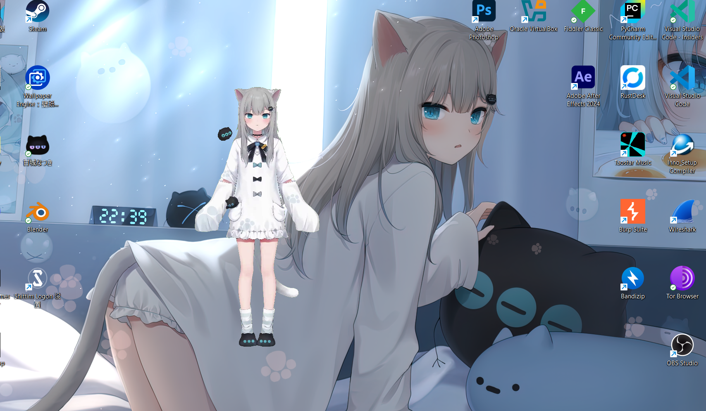
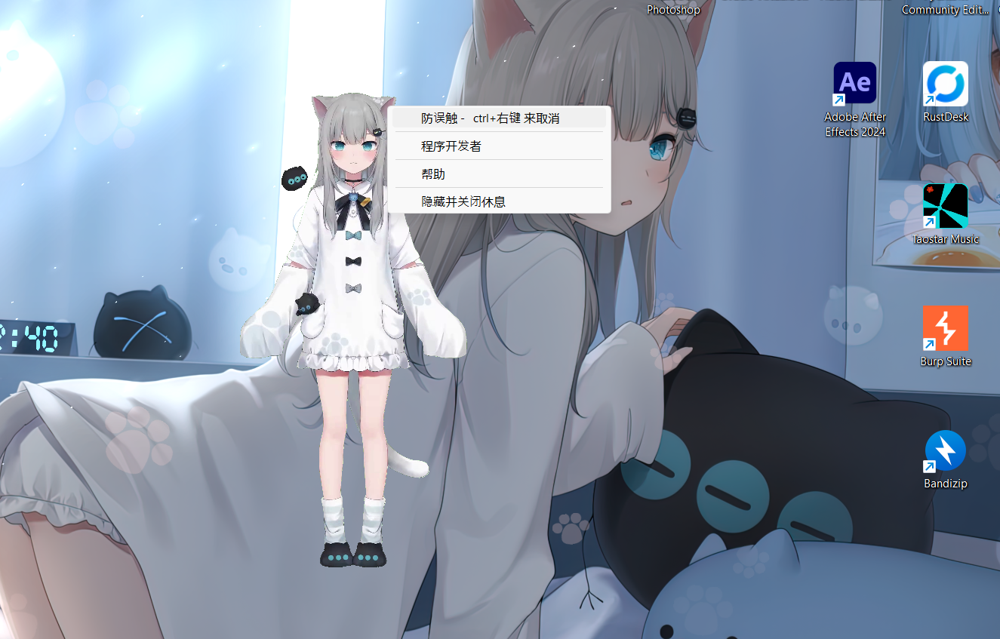

# Nachoneko桌面陪伴程序
Huoshi Studio（火狮工作室）开发的桌面角色陪伴程序，当前已接入甘城なつき（Nachoneko／甘城猫猫）。

- 桌面悬浮角色陪伴，支持穿透点击防误触，不影响正常操作电脑。

- 性能：CPU 约 0.1%–0.6%，内存约 170MB，主打轻量低占用。

- GitHub 项目，后续计划添加更多角色。

- 展示：
  
1 可拖动位置 （长按即可调整位置）:

 
2 鼠标右键选项:

 
- 可在Release下载exe可执行文件
- 仅支持 Windows 11 系统

*火狮桃星 Huoshi Taostar*
